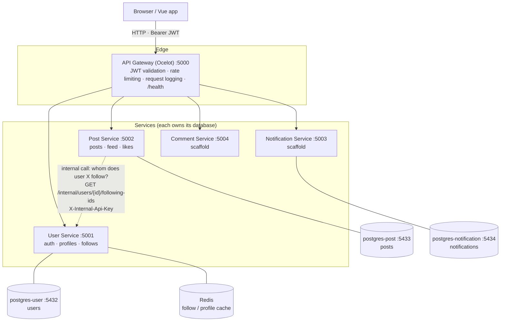
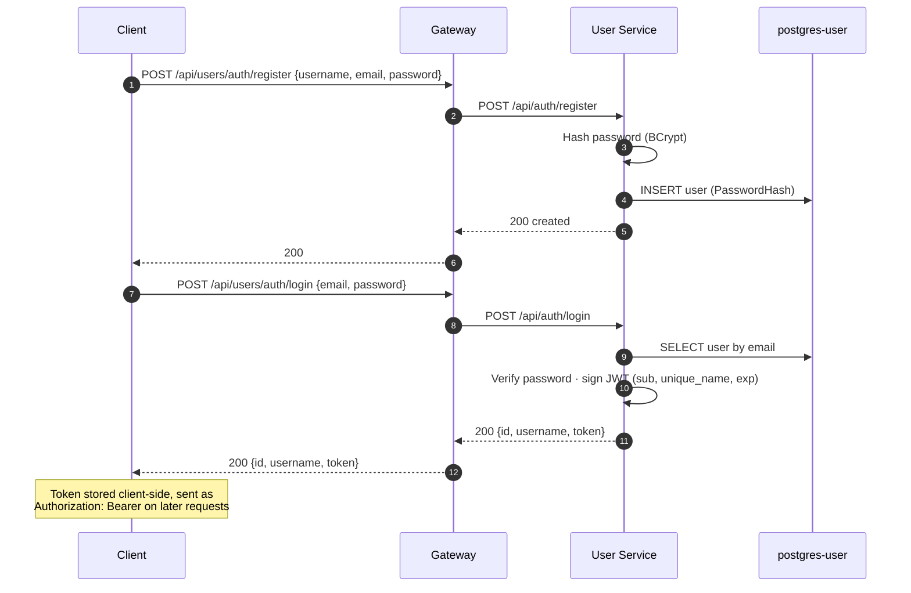
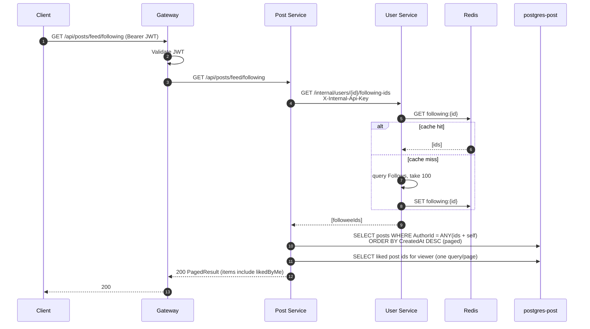
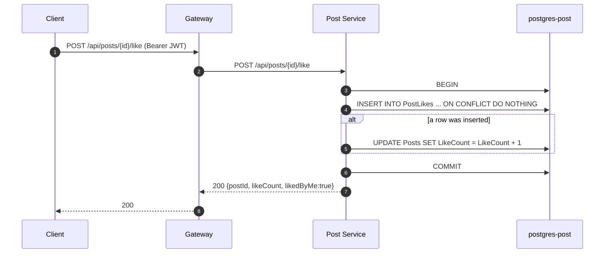
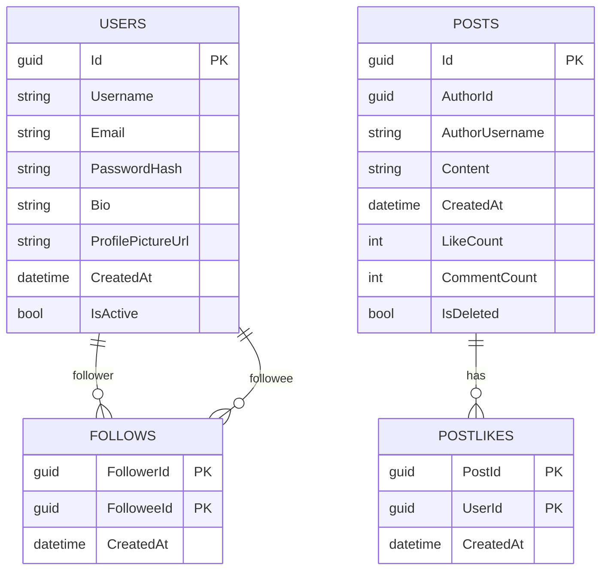

# SocialPlatform – Backend

A microservices backend for a social platform, built with **ASP.NET Core 8**, **PostgreSQL**, **Redis**, and an **Ocelot** API gateway. Clients talk only to the gateway, which authenticates requests and routes each to the right service. Services are also allowed to call each other over a private, key-protected internal channel.

## Architecture



Each service owns its own database — no service reads another's tables. When the Post Service needs data it doesn't own (e.g. who a user follows, to build the Following feed), it makes an HTTP call to the owning service over a private `internal/*` route guarded by a shared API key, never a direct database read.

| Component | Path | Port | Status |
|---|---|---|---|
| API Gateway | `gateway/ApiGateway` | 5000 | Routing, JWT auth, rate limiting, request logging, `/health` |
| User Service | `services/user-service/UserService` | 5001 | Registration, login (JWT), profiles, follow/unfollow, search, internal following-ids API |
| Post Service | `services/post-service/PostService` | 5002 | Create/delete post, get post, paged feed, following feed, likes |
| Notification Service | `services/notification-service/NotificationService` | 5003 | Scaffold only (`/health`) |
| Comment Service | `services/comment-service/CommentService` | 5004 | Scaffold only (`/health`) |
| Shared library | `shared/Shared` | – | Shared code referenced by all services |

## Key flows

### Registration & login

A successful login returns a signed JWT. The gateway and every protected service validate that token with the same shared secret; the User Service is the only one that signs it.



### Following feed (service-to-service call)

The Post Service doesn't know who follows whom — that's the User Service's data. It asks over the internal API, which is cached in Redis. If the User Service can't be reached, the Post Service returns **503** with a friendly message rather than failing opaquely.



> If the User Service call times out (3s) or returns an error (e.g. a wrong internal key), the Post Service throws `DependencyUnavailableException`, which the exception handler maps to **503**. The client falls back to the Everyone feed.

### Liking a post

Likes are made race-safe in the database rather than with a read-then-write in C#.



## Data model

Each service's database is independent; IDs are the only thing shared across boundaries (there are no cross-database foreign keys).



- `POSTS` and `POSTLIKES` live in `postgres-post`; `USERS` and `FOLLOWS` live in `postgres-user`. The relationship lines across that boundary are logical (by id), not enforced foreign keys.
- `AuthorUsername` is a denormalized copy taken from the JWT at post-creation time, so the feed can show names without calling the User Service per post.
- `LikeCount` / `CommentCount` are maintained counters on `POSTS`, updated atomically in the database.

## Tech stack

- .NET 8 / ASP.NET Core Web API
- Entity Framework Core 8 + Npgsql (PostgreSQL 15)
- Redis (`StackExchangeRedisCache`) for the User Service's follow/profile cache
- Ocelot API gateway
- JWT bearer authentication; BCrypt password hashing
- Shared-key (`X-Internal-Api-Key`) auth for internal service-to-service routes, compared in constant time
- Serilog (console + daily rolling files under each project's `logs/`)
- Swagger / Swashbuckle (Development environment only)

## Prerequisites

- [.NET 8 SDK](https://dotnet.microsoft.com/download)
- [Docker](https://www.docker.com/) (for PostgreSQL and Redis)
- Optional: `dotnet-ef` for creating migrations — `dotnet tool install --global dotnet-ef`

## Getting started

### 1. Start the databases

```bash
docker compose up -d postgres-user postgres-post postgres-notification
```

| Container | Host port | Database |
|---|---|---|
| postgres-user | 5432 | `users` |
| postgres-post | 5433 | `posts` |
| postgres-notification | 5434 | `notifications` |

Default credentials are `postgres` / `postgres`. The User Service also needs a Redis instance (a local `redis:7` container or any reachable Redis); point `ConnectionStrings:Redis` at it.

### 2. Configure settings

Each service that uses a database, Redis, or JWT needs its own settings. Example for a service:

```json
{
  "ConnectionStrings": {
    "DefaultConnection": "Host=localhost;Port=5432;Database=users;Username=postgres;Password=postgres",
    "Redis": "localhost:6379"
  },
  "JwtSettings": {
    "Secret": "<at least 32 random characters, identical in every service>",
    "Issuer": "social-platform",
    "Audience": "social-platform-api",
    "ExpiryMinutes": 1440
  }
}
```

- Use port **5433** / database `posts` for the Post Service, and port **5434** / database `notifications` for the Notification Service.
- The gateway needs the same `JwtSettings`.
- `JwtSettings.Secret` must be identical in the User Service (which signs tokens) and in the gateway and Post Service (which validate them).
- The Post Service also needs `Services:UserService` (the User Service base URL, e.g. `http://localhost:5001/`) and an `InternalApi:Key` that matches the User Service's.

**Secrets:** keep `JwtSettings:Secret` and `InternalApi:Key` out of committed files — use user secrets:

```bash
dotnet user-secrets set "JwtSettings:Secret" "<your-secret>" --project services/user-service/UserService
dotnet user-secrets set "InternalApi:Key" "<shared-internal-key>" --project services/user-service/UserService
dotnet user-secrets set "InternalApi:Key" "<shared-internal-key>" --project services/post-service/PostService
```

> ⚠️ The JWT secret and internal API key are currently committed in `appsettings.json`. Treat those values as compromised: rotate them and move them to user secrets / environment variables before this goes anywhere real.

### 3. Run the services

Open `SocialPlatform.sln` in Visual Studio and set multiple startup projects, or run each in its own terminal:

```bash
dotnet run --project services/user-service/UserService
dotnet run --project services/post-service/PostService
dotnet run --project services/notification-service/NotificationService
dotnet run --project services/comment-service/CommentService
dotnet run --project gateway/ApiGateway
```

The User and Post services apply EF Core migrations automatically on startup. Swagger UI is at `http://localhost:<port>/swagger` in Development.

## API

All requests go through the gateway at `http://localhost:5000`.

### Users — `/api/users/*` → User Service `/api/*`

| Method | Gateway path | Auth | Description |
|---|---|---|---|
| POST | `/api/users/auth/register` | – | Register (`username`, `email`, `password`) |
| POST | `/api/users/auth/login` | – | Log in (`email`, `password`); returns `id`, `username`, `token` |
| GET | `/api/users/auth/{id}` | – | Get a user by ID |
| GET | `/api/users/auth/health` | – | Health check |
| GET | `/api/users/profiles/me` | Bearer | Current user's profile (includes email) |
| PUT | `/api/users/profiles/me` | Bearer | Update own `bio` / `profilePictureUrl` |
| GET | `/api/users/profiles/{id}` | Bearer | A user's public profile (`isFollowing`, `isMe`) |
| POST | `/api/users/profiles/{id}/follow` | Bearer | Follow a user |
| DELETE | `/api/users/profiles/{id}/follow` | Bearer | Unfollow a user |
| GET | `/api/users/profiles/{id}/followers` | Bearer | Paged followers |
| GET | `/api/users/profiles/{id}/following` | Bearer | Paged following |
| GET | `/api/users/profiles/search?query=&limit=` | Bearer | Search users |

### Posts — `/api/posts/*` → Post Service

| Method | Gateway path | Auth | Description |
|---|---|---|---|
| POST | `/api/posts` | Bearer | Create a post (`content`) |
| GET | `/api/posts/{id}` | optional | Get a post by ID (`likedByMe` set if a token is sent) |
| GET | `/api/posts/feed?pageNumber=1&pageSize=10` | optional | Everyone feed, newest first |
| GET | `/api/posts/feed/following?pageNumber=1&pageSize=10` | Bearer | Posts from people you follow (plus your own) |
| GET | `/api/posts/user/{userId}?pageNumber=1&pageSize=10` | optional | A single user's posts |
| DELETE | `/api/posts/{id}` | Bearer | Soft-delete your own post |
| POST | `/api/posts/{id}/like` | Bearer | Like a post → `{postId, likeCount, likedByMe}` |
| DELETE | `/api/posts/{id}/like` | Bearer | Unlike a post |
| GET | `/api/posts/health` | – | Health check |

Endpoints marked *optional* work without a token; sending a valid one additionally populates `likedByMe`.

### Internal (not routed through the gateway)

| Method | Path | Auth | Description |
|---|---|---|---|
| GET | `/internal/users/{id}/following-ids` | `X-Internal-Api-Key` | IDs this user follows (used by the Post Service for the Following feed) |

These routes are called service-to-service only, are hidden from Swagger, and reject any request without the shared key.

### Notifications and comments

`/api/notifications/*` and `/api/comments/*` are routed to their services, which don't expose endpoints yet.

### Example

```bash
# Register
curl -X POST http://localhost:5000/api/users/auth/register \
  -H "Content-Type: application/json" \
  -d '{"username":"alice","email":"alice@example.com","password":"P@ssw0rd!"}'

# Log in and copy the token
curl -X POST http://localhost:5000/api/users/auth/login \
  -H "Content-Type: application/json" \
  -d '{"email":"alice@example.com","password":"P@ssw0rd!"}'

# Create a post
curl -X POST http://localhost:5000/api/posts \
  -H "Authorization: Bearer <token>" \
  -H "Content-Type: application/json" \
  -d '{"content":"Hello, world!"}'

# Like it
curl -X POST http://localhost:5000/api/posts/<postId>/like \
  -H "Authorization: Bearer <token>"
```

## Rate limits

Set per route in `gateway/ApiGateway/ocelot.json`. Requests over the limit get HTTP `429`.

| Route | Limit |
|---|---|
| Users | 100 / min |
| Posts | 150 / min |
| Comments | 100 / min |
| Notifications | none |

## Database migrations

```bash
dotnet ef migrations add <Name> --project services/user-service/UserService
dotnet ef migrations add <Name> --project services/post-service/PostService
```

> Tip: if a service is already running, its build output is locked. Build the EF tooling into a separate configuration (e.g. `--configuration EfTooling`) to add a migration without stopping the running service.

## Project structure

```
backend/
├── SocialPlatform.sln
├── docker-compose.yml
├── gateway/
│   └── ApiGateway/          # Ocelot config (ocelot.json), JWT, rate limiting, logging
├── services/
│   ├── user-service/        # Controllers (Auth, Profiles, Internal), Data, Models, Services, Migrations
│   ├── post-service/        # Controllers, Services, Clients (UserServiceClient), Data, Migrations
│   ├── notification-service/
│   └── comment-service/
└── shared/
    └── Shared/              # Shared class library
```

## Known gaps

- `docker-compose.yml` defines containers for the gateway and services, but there are no Dockerfiles yet, and the build contexts (`./backend/...`) assume compose runs from the repository root. For now, use compose only for the databases (and Redis).
- `ocelot.json` points downstream services at `localhost`. Running the services in Docker would require changing these to container names, and the Post Service's `Services:UserService` URL too.
- Secrets (JWT, internal API key) are checked into `appsettings.json` — see the warning above.
- The Notification and Comment services are scaffolds with no endpoints yet.
